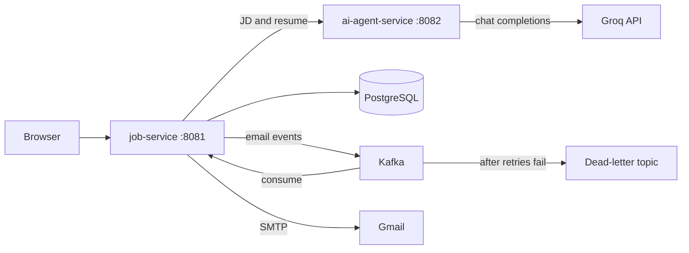

# AI Job Tracker

Track job applications, analyse job descriptions with AI, and send cold-mail campaigns to recruiters, all in one app with per-user accounts.

## Features

- **Application tracker:** add, edit and delete applications, with status (Applied, Interview, Offer, Rejected), source, notes and follow-up dates
- **Dashboard:** counts per status, average fit score and pending follow-ups
- **AI JD analysis:** paste a job description and your resume to get extracted skills, a fit score (0-100) and a short reason, powered by an LLM on Groq
- **Cold-mail campaigns:** send personalised emails to several HRs at once, with a resume attachment
- **Email templates:** save subject and body templates and reuse them in campaigns
- **Open and reply tracking:** a tracking pixel records opens, and replies can be marked per recipient
- **Async email pipeline:** emails are sent through Kafka with retries and a dead-letter topic
- **Authentication:** email and password, Google sign-in, and JWT tokens for the REST API
- **Per-user data:** every user sees only their own applications, campaigns and templates

## Architecture



| Service | Port | Role |
|---|---|---|
| `job-service` | 8081 | Web UI (Thymeleaf), REST API, auth, database, Kafka producer and consumer |
| `ai-agent-service` | 8082 | Calls Groq to analyse job descriptions. Has no login, so keep it internal |

## Tech stack

Java 17+, Spring Boot 3.2, Spring Security (form login, OAuth2/OIDC, JWT with JJWT), Spring Data JPA, PostgreSQL, Apache Kafka, Thymeleaf and Bootstrap 5, WebClient, Groq API (`openai/gpt-oss-120b`), Docker Compose. Redis is provisioned in Compose but not used yet.

## Project structure

```
ai-job-tracker/
├── job-tracker/
│   ├── job-service/          # UI, REST API, auth, Kafka, JPA
│   ├── ai-agent-service/     # Groq integration
│   ├── docker-compose.yml
│   └── .env.example
├── project_flow.md
└── README.md
```

## Getting started

### Prerequisites

- JDK 17+, Maven, Docker
- A [Groq](https://console.groq.com) API key (the free plan works)
- A Gmail address with an [app password](https://myaccount.google.com/apppasswords) for sending campaigns
- *(Optional)* a Google OAuth client for "Continue with Google"

### 1. Clone

```bash
git clone https://github.com/AdityaDeveloper-pixel/ai-job-tracker.git
cd ai-job-tracker/job-tracker
```

### 2. Configure secrets

Secrets are read from environment variables and are never committed. Copy the example file and fill it in:

```bash
cp .env.example .env
```

| Variable | Used by | Notes |
|---|---|---|
| `JWT_SECRET` | job-service | At least 32 random characters. The app refuses to start without it |
| `GROQ_API_KEY` | ai-agent-service | From the Groq console |
| `DB_PASSWORD` | job-service, Postgres | |
| `GMAIL_USERNAME`, `GMAIL_APP_PASSWORD` | job-service | Used to send campaign emails |
| `GOOGLE_CLIENT_ID`, `GOOGLE_CLIENT_SECRET` | job-service | Optional. Without them, the Google button fails |

Spring does not read `.env` by itself. Docker Compose does. When you run a service from your IDE, set the same variables in the run configuration.

### 3. Run

**Infrastructure with Docker, services from your IDE or Maven:**

```bash
docker compose up -d postgres kafka redis

# terminal 1
cd ai-agent-service && mvn spring-boot:run

# terminal 2
cd job-service && mvn spring-boot:run
```

Open <http://localhost:8081>. You will be sent to the login page. Register an account and sign in.

**Everything in Docker:** `docker compose up --build`

### Google sign-in setup (optional)

1. In Google Cloud, open **Google Auth Platform**, set up the consent screen as *External*, and add your Gmail as a test user.
2. Create an OAuth client of type *Web application*.
3. Add this authorized redirect URI: `http://localhost:8081/login/oauth2/code/google`
4. Put the client ID and secret in `GOOGLE_CLIENT_ID` and `GOOGLE_CLIENT_SECRET`.

A Google email that already belongs to a password account is rejected, so accounts are never merged silently.

## API

All endpoints except `/api/auth/**` need a `Authorization: Bearer <token>` header.

```bash
# 1. get a token
curl -X POST http://localhost:8081/api/auth/login \
  -H "Content-Type: application/json" \
  -d '{"email":"you@example.com","password":"your-password"}'

# 2. use it
curl -X POST http://localhost:8081/api/analyse \
  -H "Authorization: Bearer <token>" \
  -H "Content-Type: application/json" \
  -d '{"jdText":"Java developer, Spring Boot, Kafka","resumeText":"..."}'
```

| Method | Endpoint | Description |
|---|---|---|
| POST | `/api/auth/register` | Create an account, returns a JWT |
| POST | `/api/auth/login` | Log in, returns a JWT |
| GET, POST | `/api/jobs` | List or create your applications |
| GET, PUT, DELETE | `/api/jobs/{id}` | Read, update or delete one application |
| POST | `/api/analyse` | Analyse a job description against a resume |

The AI service also exposes `POST /api/ai/analyze` on port 8082, for internal use only.

## How email campaigns work

1. A campaign is saved with one recipient row per HR address.
2. An event for each recipient is published to Kafka.
3. A consumer sends the email over SMTP, with the resume attached, and marks the recipient as sent.
4. If sending fails, the event is retried and then moved to a dead-letter topic.
5. Each email contains a small tracking pixel. When the recipient's mail client loads it, the open is recorded.

## Security notes

- Passwords are hashed with BCrypt. JWTs expire after 24 hours.
- Web forms are protected with CSRF tokens. Bearer-token API requests are exempt, since they use no cookies.
- Every query is scoped to the logged-in user. Another user's record returns 404.
- Do not expose `ai-agent-service` (port 8082) publicly, because it has no authentication.

## Troubleshooting

| Problem | Likely fix |
|---|---|
| `Could not resolve placeholder 'JWT_SECRET'` | Set `JWT_SECRET` (32+ characters) in your environment or IDE run configuration, then restart |
| AI analysis returns "AI analysis failed" | Check that `ai-agent-service` is running and that `GROQ_API_KEY` is set for **that** service. Also check that the configured Groq model is still available |
| Google error `redirect_uri_mismatch` | The redirect URI in Google Cloud must match exactly, including `http` and the port |
| Google "Access blocked" | Add your account under **Test users** on the consent screen |
| `Error resolving template [auth/login]` | The file must be at `src/main/resources/templates/auth/login.html` |
| A page POST returns 403 | The form or script is not sending the CSRF token |

## Known limitations and roadmap

- [ ] Send campaign emails from each user's own mailbox (currently one shared Gmail account)
- [ ] Fix Kafka retry back-off, store resumes outside the message, and make the consumer idempotent
- [ ] Random tokens for the tracking pixel instead of sequential IDs
- [ ] Cache AI results in Redis
- [ ] Flyway migrations, automated tests and a CI pipeline
- [ ] Google sign-in endpoint for mobile and SPA clients, and refresh tokens
- [ ] Deployment with HTTPS

## Contributing

Open an issue to discuss a change first, then submit a pull request from a feature branch.

## 🔒 Security Notes

- Never commit `application.properties` with real credentials to GitHub
- `.gitignore` already excludes `.env`
- Gmail App Password ≠ your Gmail login password

---


## 👨‍💻 Author

**[Aditya Singh]** — Java Developer | Spring Boot | Microservices

- GitHub: [@AdityaDeveloper-pixel](https://github.com/AdityaDeveloper-pixel)
- LinkedIn: [linkedin.com/in/aditya-singh-234739161](https://www.linkedin.com/in/aditya-singh-234739161)

---

## 📄 License

MIT — free to use, modify, and share.