# 🧭 AI Job Tracker — Project Flow

## 🏗️ High-Level Architecture

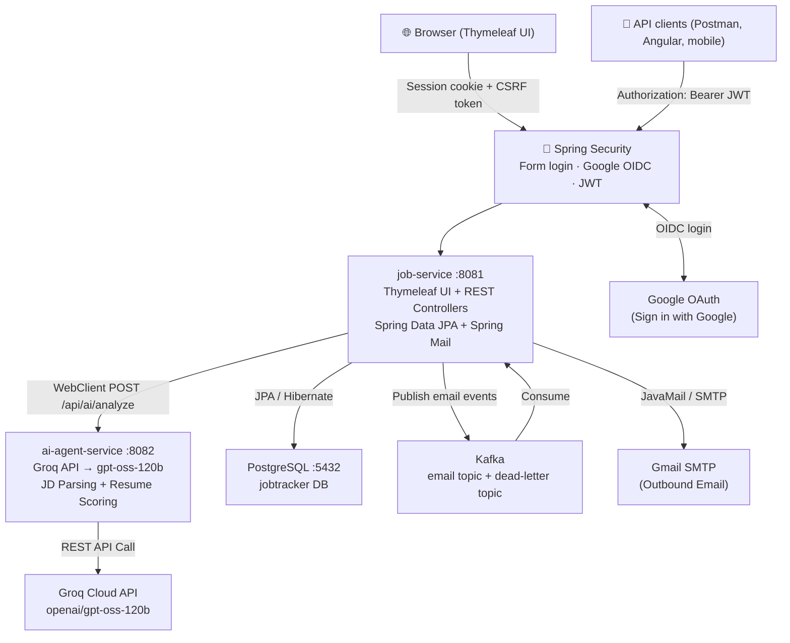

---

## 📦 Microservices Overview

| Service | Port | Role |
|---|---|---|
| `job-service` | 8081 | Main app — UI, auth, CRUD, email, tracking, Kafka producer + consumer |
| `ai-agent-service` | 8082 | AI proxy — JD parsing & resume scoring. **No login — keep internal** |
| PostgreSQL | 5432 | Persistent storage (one shared database, rows scoped by `user_id`) |
| Kafka | 9092 | Async email pipeline: `email` topic + dead-letter topic |
| Redis | 6379 | Defined in Docker (not used yet — planned AI result cache) |

---

## 🔐 Authentication & Per-User Data

### Ways to sign in

| Client | How | Result |
|---|---|---|
| Browser (Thymeleaf pages) | Email + password at `/login`, or **Continue with Google** | Session cookie (JSESSIONID) |
| API client (Postman, Angular, mobile) | `POST /api/auth/login` | JWT, sent as `Authorization: Bearer <token>` |

All three paths end up with the same identity: **the user's email**. That is what the app uses to find "the current user".

### Password login (web)

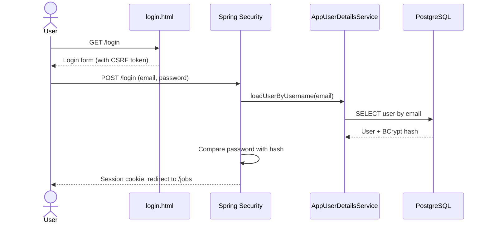

### Google sign-in / sign-up

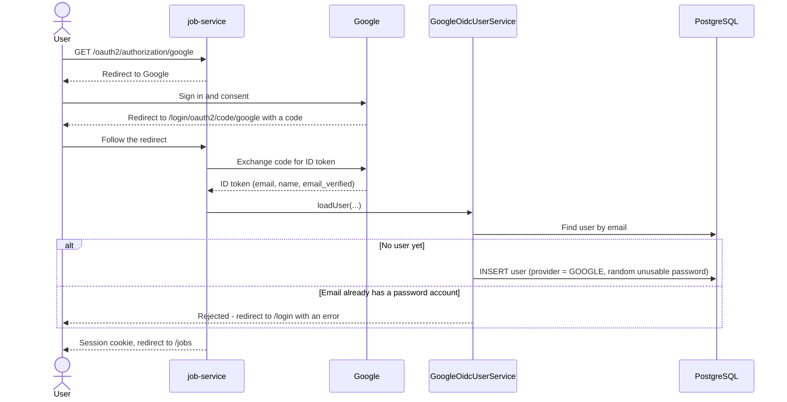

Google users never have a usable password. A Google email that already belongs to a password account is rejected on purpose, so accounts are never merged silently.

### JWT for API clients

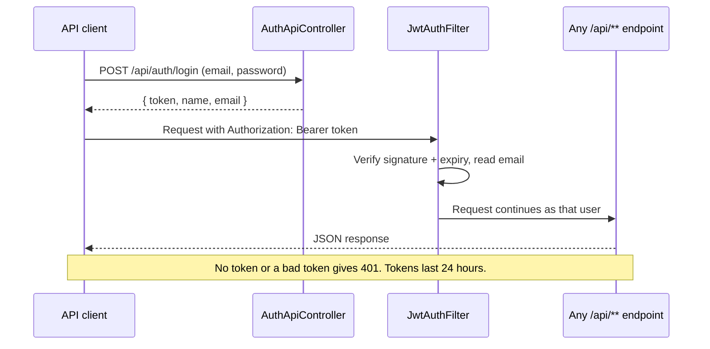

There is no server-side logout for JWTs. The client just deletes the token.

### How a request is secured and scoped

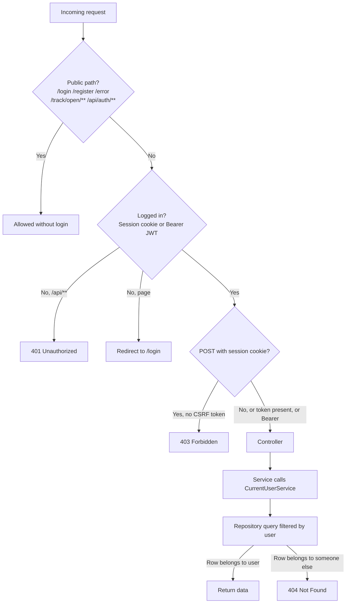

### Per-user data rule

- `job_applications`, `email_campaigns` and `email_templates` each have a `user_id` owner.
- Every service method works on the logged-in user's rows only (`findByIdAndUser`, `findByUser...`).
- Asking for another user's record returns **404**, so the ID is not even confirmed to exist.
- The owner field is hidden from JSON responses.
- Public exception: `/track/open/{recipientId}` has to work without a login, because it is loaded by the HR's mail client.

---

## 🔄 Core User Flows

### 1. 📊 Add a Job Application

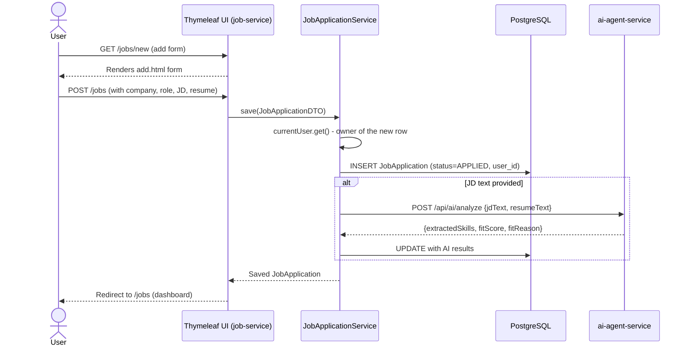

Edit works the same way: `GET /jobs/{id}/edit` shows a pre-filled form, `POST /jobs/{id}/edit` saves it, and `POST /jobs/{id}/reanalyse` re-runs the AI. All three look the record up by id **and** owner.

---

### 2. 🔍 JD Analyser (Standalone AI Analysis)

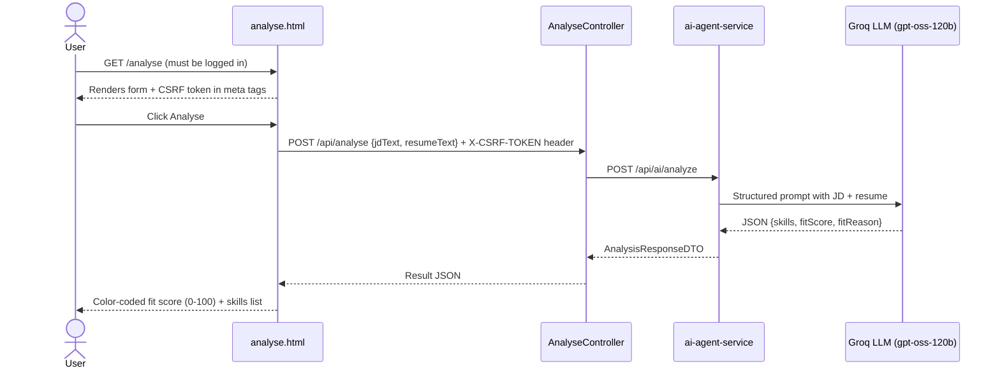

From the browser the page sends the session cookie and the CSRF token. From Postman or other API clients you send a Bearer token instead.

---

### 3. 📧 Cold Mail Campaign Flow (async, via Kafka)

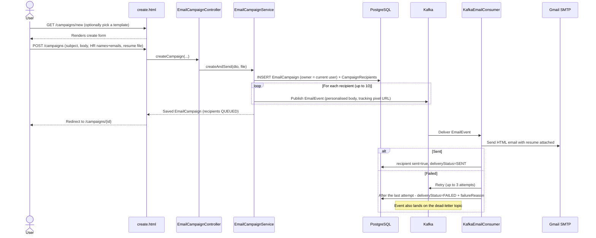

The consumer runs in the background with no logged-in user. It works from the recipient id carried in the event.

---

### 4. 📬 Email Open Tracking Flow

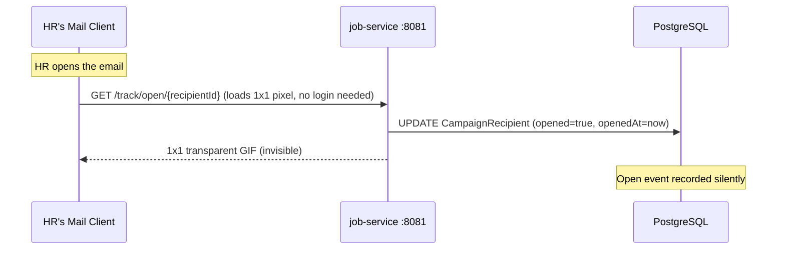

Replies are marked by the owner with `POST /campaigns/recipients/{id}/replied`, which checks that the recipient belongs to one of that user's campaigns.

---

## 🧠 AI Agent — Internal Flow

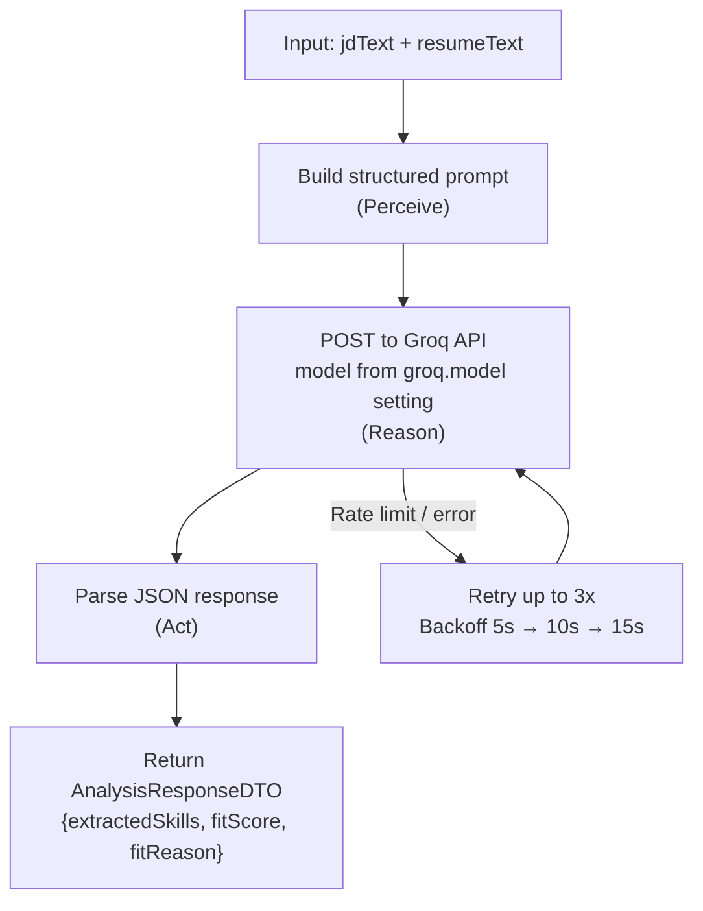

Groq retires models from time to time (`llama-3.3-70b-versatile` was shut down in August 2026), so the model name is a setting, not hard-coded.

---

## 🗄️ Data Model

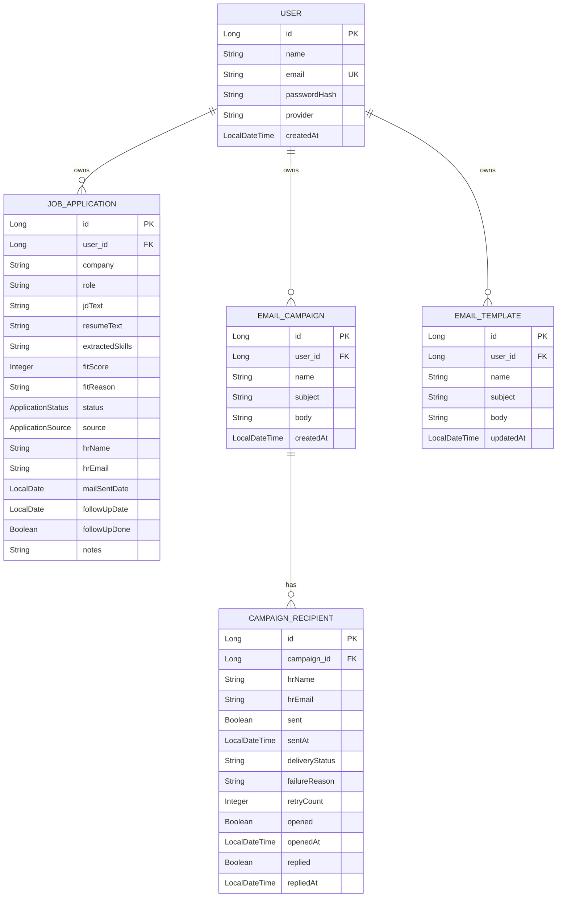

`provider` is `LOCAL` for password accounts and `GOOGLE` for Google sign-ins. Recipients have no `user_id`: they belong to a campaign, and the campaign has the owner.

---

## 📡 Endpoint Surface

### job-service (`:8081`)

**Public (no login):**

| Method | Endpoint | Description |
|---|---|---|
| `GET` | `/login` | Login page |
| `POST` | `/login` | Form login (handled by Spring Security) |
| `GET`, `POST` | `/register` | Register page and form |
| `GET` | `/oauth2/authorization/google` | Starts Google sign-in |
| `POST` | `/api/auth/register` | Create account, returns JWT |
| `POST` | `/api/auth/login` | Log in, returns JWT |
| `GET` | `/track/open/{recipientId}` | Open-tracking pixel |

**Needs login** (session cookie, or Bearer JWT for `/api/**`):

| Method | Endpoint | Handler | Description |
|---|---|---|---|
| `POST` | `/logout` | Spring Security | Log out (needs CSRF token) |
| `GET` | `/jobs` | `JobApplicationController` | Dashboard with stats |
| `GET` | `/jobs/new` | `JobApplicationController` | Add form |
| `POST` | `/jobs` | `JobApplicationController` | Save + trigger AI |
| `GET` | `/jobs/{id}` | `JobApplicationController` | Detail view |
| `GET` | `/jobs/{id}/edit` | `JobApplicationController` | Edit form |
| `POST` | `/jobs/{id}/edit` | `JobApplicationController` | Save edit |
| `POST` | `/jobs/{id}/reanalyse` | `JobApplicationController` | Re-run AI analysis |
| `POST` | `/jobs/{id}/status` | `JobApplicationController` | Update status |
| `POST` | `/jobs/{id}/followup` | `JobApplicationController` | Mark follow-up done |
| `POST` | `/jobs/{id}/delete` | `JobApplicationController` | Delete |
| `GET` | `/analyse` | `AnalyseController` | JD Analyser page |
| `POST` | `/api/analyse` | `AnalyseController` | AI proxy endpoint |
| `GET` | `/campaigns` | `EmailCampaignController` | Campaign list |
| `GET` | `/campaigns/new` | `EmailCampaignController` | Create form |
| `POST` | `/campaigns` | `EmailCampaignController` | Create + queue emails |
| `GET` | `/campaigns/{id}` | `EmailCampaignController` | Campaign tracking |
| `POST` | `/campaigns/recipients/{id}/replied` | `EmailCampaignController` | Mark replied |
| `POST` | `/campaigns/{id}/delete` | `EmailCampaignController` | Delete campaign |
| `GET` | `/templates` | `EmailTemplateController` | Template list |
| `GET` | `/templates/new` | `EmailTemplateController` | New template form |
| `POST` | `/templates` | `EmailTemplateController` | Create template |
| `GET`, `POST` | `/templates/{id}/edit` | `EmailTemplateController` | Edit template |
| `POST` | `/templates/{id}/delete` | `EmailTemplateController` | Delete template |
| `GET` | `/api/templates/{id}` | `EmailTemplateController` | Template as JSON (campaign form) |

**REST API for jobs** (`JobApplicationRestController`, Bearer JWT):

| Method | Endpoint | Description |
|---|---|---|
| `GET` | `/api/jobs` | List your applications |
| `GET` | `/api/jobs/{id}` | Get one |
| `POST` | `/api/jobs` | Create |
| `PUT` | `/api/jobs/{id}` | Update |
| `POST` | `/api/jobs/{id}/reanalyse` | Re-run AI |
| `PUT` | `/api/jobs/{id}/status` | Update status |
| `PUT` | `/api/jobs/{id}/followup` | Mark follow-up done |
| `DELETE` | `/api/jobs/{id}` | Delete |
| `GET` | `/api/jobs/pending-followups` | Follow-ups that are due |
| `GET` | `/api/jobs/stats` | Dashboard numbers |

### ai-agent-service (`:8082`, no authentication)

| Method | Endpoint | Description |
|---|---|---|
| `POST` | `/api/ai/analyze` | Parse JD + score resume |
| `GET` | `/api/ai/health` | Health check |

---

## 🔁 Status Lifecycle

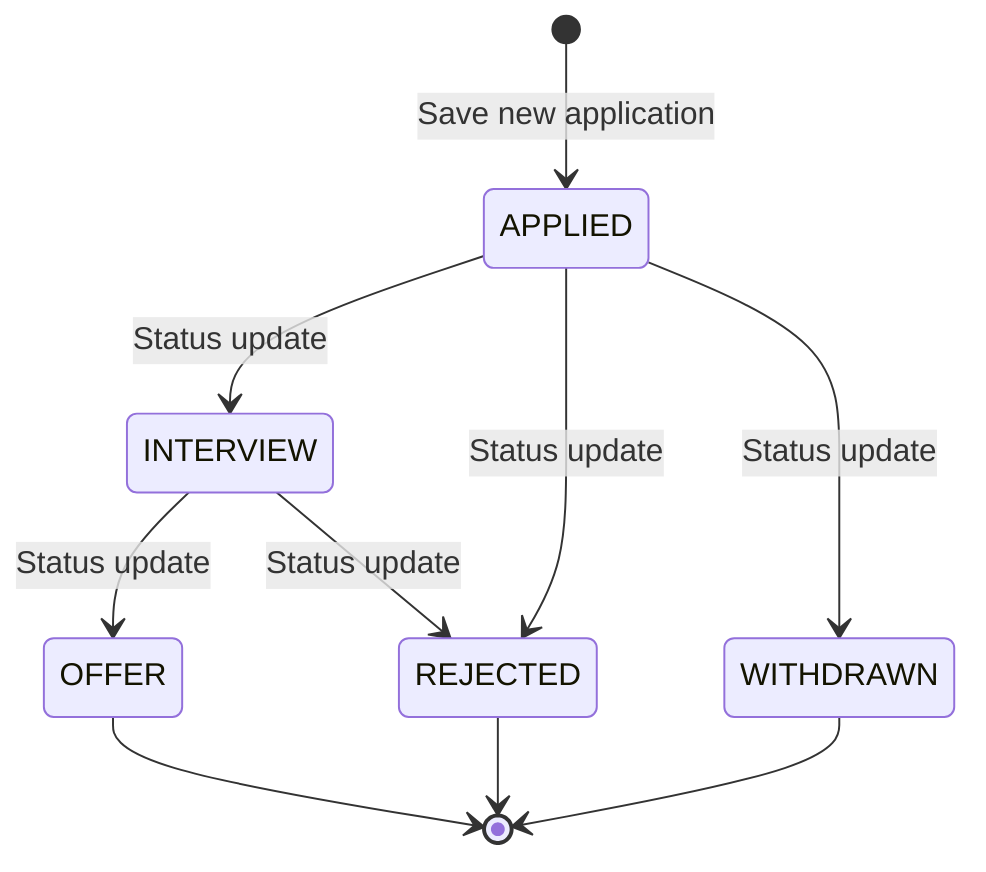

---

## 🐳 Docker Compose Topology

```
docker compose up
│
├── postgres (port 5432)         ← job-service depends on this
├── redis (port 6379)            ← provisioned, future use
├── kafka (port 9092)            ← email events + dead-letter topic
├── ai-agent-service (port 8082) ← needs GROQ_API_KEY
└── job-service (port 8081)      ← needs JWT_SECRET, DB_PASSWORD, Gmail + Google credentials
        │
        ├── connects to postgres via JDBC
        ├── connects to kafka (produces and consumes email events)
        ├── connects to ai-agent-service via WebClient
        └── connects to Gmail via SMTP
```

### Environment variables

| Variable | Used by |
|---|---|
| `JWT_SECRET` (32+ characters) | job-service |
| `GOOGLE_CLIENT_ID`, `GOOGLE_CLIENT_SECRET` | job-service (Google sign-in) |
| `GMAIL_USERNAME`, `GMAIL_APP_PASSWORD` | job-service (campaign emails) |
| `DB_PASSWORD` | job-service, postgres |
| `GROQ_API_KEY` | ai-agent-service |

Secrets live in `.env` or the IDE run configuration, never in committed files.

---

## 🚧 Current Limitations

- Campaign emails still go out from one shared Gmail account (per-user sending is planned).
- The tracking pixel uses sequential recipient IDs (random tokens planned).
- Kafka retries have no delay between attempts, and the resume travels inside the message (fix planned).
- `ai-agent-service` has no authentication, so it must not be exposed publicly.
- Redis is provisioned but unused.